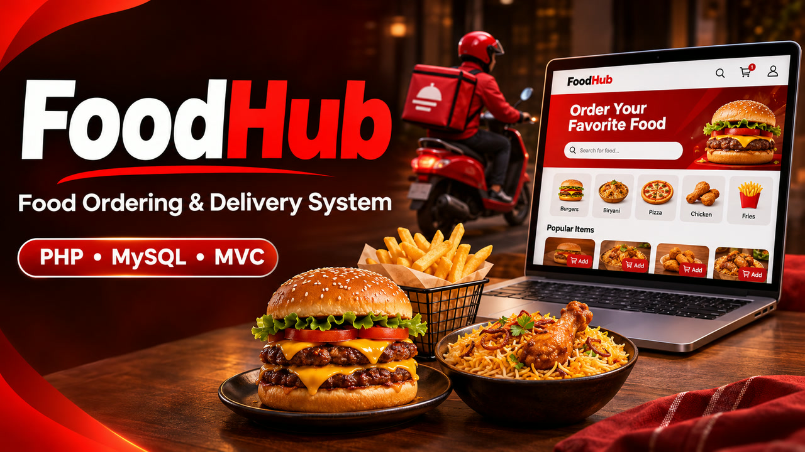
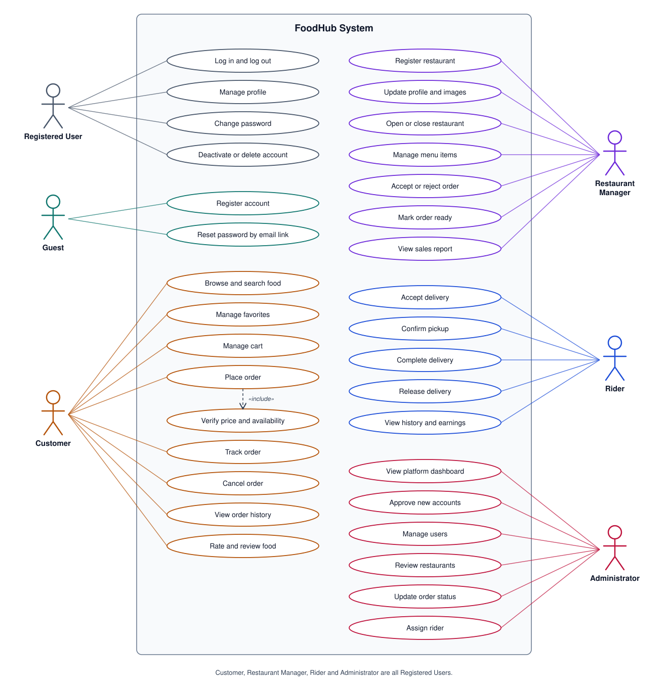
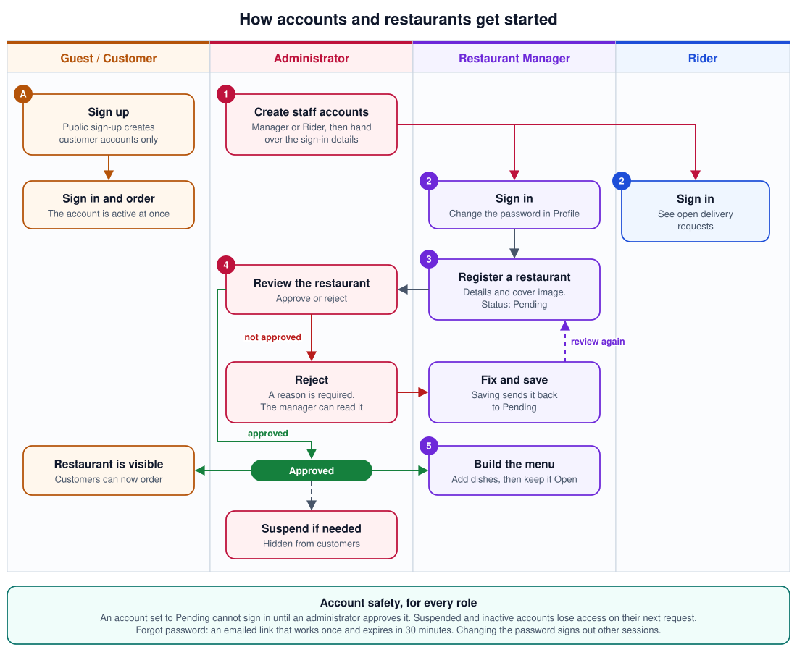
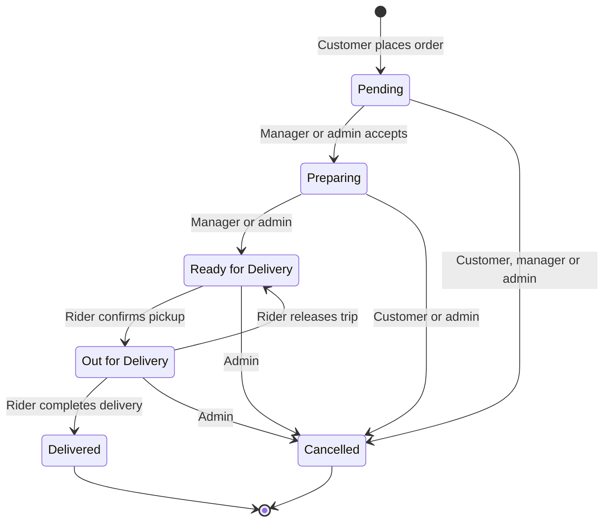
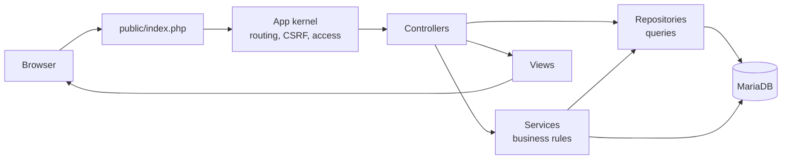

# 🍔 FoodHub: Online Food Ordering and Delivery System

FoodHub is a multi-role web application that covers the full life of a food order: a customer places it, a restaurant prepares it, a rider delivers it and an administrator oversees the platform.

It started as a university group project for a **Web Technologies** course. Version 3.0.0 rebuilds it in plain PHP with an object-oriented MVC structure, a single front controller, PDO and an automated test suite. It uses no framework and has no third-party PHP dependencies.

## Demo video

[](https://youtu.be/8NahOGip0Uc)

A 19-minute walkthrough of the application. Click the picture to watch it, or use one of these links:

| | |
|:---|:---|
| ▶️ **Watch online** | [youtu.be/8NahOGip0Uc](https://youtu.be/8NahOGip0Uc) |
| ⬇️ **Download** | [FoodHub-demo.mp4](https://github.com/Jisan179/FoodHub/releases/download/v3.0.0/FoodHub-demo.mp4) (MP4, 1080p, about 218 MB) |

The recording has background music and no voice-over. Some parts are blurred to hide private information. The thumbnail is an AI-generated illustration, not a screenshot of the application.

<sub>Music: Fall Asleep by [Tokyo Music Walker](https://soundcloud.com/user-356546060), licensed under [CC BY 3.0](https://creativecommons.org/licenses/by/3.0/). [Free download / stream](https://links.al/gOA). Music promoted by [Audio Library](https://links.al/youtube). The track is looped and its volume is lowered in this video.</sub>

## Contents

- [Demo video](#demo-video)
- [Version history](#version-history)
- [Features](#features)
- [Use case diagram](#use-case-diagram)
- [How it works](#how-it-works)
- [Order lifecycle](#order-lifecycle)
- [Tech stack](#tech-stack)
- [Architecture](#architecture)
- [Database](#database)
- [Security](#security)
- [Getting started](#getting-started)
- [Testing](#testing)
- [Known limitations and roadmap](#known-limitations-and-roadmap)
- [Team and credits](#team-and-credits)

## Version history

| Version | Summary |
|:---|:---|
| **3.0.0** | Rewrite: new architecture and interface, new database schema, new features, automated tests and CI |
| [2.0.0](https://github.com/Jisan179/FoodHub/releases/tag/v2.0.0) | Security, correctness and layout fixes on top of 1.0.0 |
| [1.0.0](https://github.com/Jisan179/FoodHub/releases/tag/v1.0.0) | Final version of the university group project, built by a team of four |

Version 3.0.0 is not a drop-in upgrade. It uses a new database (`foodhub_v3` by default) and does not migrate data from earlier versions.

## Features

### Public pages

- Sign-in, registration and password pages over a food photo background, with a show or hide button for passwords
- A site footer with About, Help, Privacy, Terms and Security pages

### Accounts

- Public registration creates Customer accounts only, enforced on the server
- Restaurant Manager and Rider accounts are created by an administrator, who hands over the sign-in details
- Accounts set to Pending cannot sign in until an administrator approves them
- Sign-in with a username or email, with rate limiting
- Password reset through an emailed link that works once and expires after 30 minutes
- Profile editing and password change. Changing the email requires the current password.
- Account deactivation, or deletion when there is no order history

### Customer

- Dashboard with order statistics, active orders and pending reviews
- Restaurant search by name with a cuisine filter, dish search by name or category, and category filters on each menu
- Favorite restaurants
- A cart limited to one restaurant, with confirmation before it is replaced
- Checkout with server-side prices inside a database transaction
- Cash on Delivery, or a **simulated** mobile wallet option (no payment gateway)
- Order tracking, order history with status filters, and cancellation while allowed
- One review per item of a delivered order, with clickable star ratings, a rating summary, edit and delete

### Restaurant Manager

- Live dashboard: seven-day order trend, today's trending dishes and the week's top dishes. New orders count at once, cancelled orders are left out, and the page refreshes itself.
- Restaurant registration and editing, with a cover image
- A button to open or close each restaurant for orders
- Menu management with images, availability and soft delete
- Order board to accept, reject and mark orders ready, plus paginated order history
- Rejected restaurants show the administrator's reason and can be resubmitted

### Rider

- Open delivery requests. Customer contact details appear only after a trip is accepted.
- Accept, confirm pickup and complete deliveries
- Route panel for each active trip: an illustrated map (not a live map), pickup and drop-off timeline, and a link that opens directions in Google Maps
- Release a trip with a reason, which returns it to the queue
- Paginated delivery history and earnings

### Administrator

- Platform overview with accounts waiting for approval and recent orders
- User management with search, filters and pagination, including creating Manager and Rider accounts
- Restaurant approval, suspension, and rejection with a required reason
- Order monitoring, allowed status changes and rider assignment

## Use case diagram

### Overview



### Complete use case diagram

Every feature, grouped by who uses it. Click the diagram to open it full size.


How to read it:

| Symbol | Meaning |
|:---|:---|
| Stick figure | An actor: a kind of user, or an outside service |
| Oval | A use case: something the actor can do, or a step the system performs |
| Solid line | The actor takes part in the use case |
| Dashed arrow `«include»` | The base use case **always** performs this step, for example *Place order* includes *Verify price and availability* |
| Dashed arrow `«extend»` | An **optional or conditional** addition that points to its base, for example *Cancel order* extends *Track orders and history* |
| Hollow arrow | Inheritance: Customer, Restaurant Manager, Rider and Administrator are each also a Registered User |

## How it works

The use case diagram shows **what** each person can do. These two workflows show **how** the work moves between them. Each column is one role, and the numbers give the usual order of the steps. Click a diagram to open it full size.

### An order, from search to review


### Accounts and restaurants



## Order lifecycle

Every status change goes through one set of rules. No role can skip a step.



A rider can accept a delivery before the food is ready, but can confirm pickup only when the order is `Ready for Delivery`. Completing a delivery marks the order as paid and records the rider's earning, which is 10% of the order total including the delivery fee.

## Tech stack

| Layer | Technology |
|:---|:---|
| Language | PHP 8.0+ with strict types |
| Database | MariaDB or MySQL through PDO prepared statements |
| Frontend | Server-rendered HTML, one stylesheet, a small vanilla JavaScript file and the Plus Jakarta Sans font from Google Fonts |
| Server | Apache with `mod_rewrite`, or PHP's built-in server for development |
| Quality | Dependency-free test runner and GitHub Actions |

## Architecture

All requests enter through `public/index.php`. The application kernel matches a route, verifies the CSRF token, checks the user's role and then calls a controller. Controllers delegate business rules to services and data access to repositories.



```text
FoodHub/
├── app/
│   ├── Core/            Kernel, router, database, session, validation, uploads
│   ├── Controllers/     HTTP handlers, grouped by role
│   ├── Models/          Repositories with the SQL queries
│   ├── Services/        Orders, deliveries, cart, checkout, accounts, password reset
│   └── routes.php       Every route and the role allowed to use it
├── bin/console          Database commands
├── config/config.php    Settings read from the environment
├── database/            Migrations and demo data
├── public/              The only web-accessible folder
├── resources/views/     Page templates
├── storage/logs/        Local mail log
├── tests/               Unit and feature tests
└── docs/                Diagrams
```

## Database

| Table | Purpose |
|:---|:---|
| `users` | Accounts, roles and account status |
| `restaurants` | Restaurant details, approval status, rejection reason and open flag |
| `food_items` | Menu items, images, availability and soft delete |
| `orders` | Totals, delivery details, payment and status |
| `order_items` | Item names and prices as they were at purchase time |
| `order_status_history` | Who changed what, and when |
| `deliveries` | Rider assignment, delivery times and earnings |
| `favorites` | Customers' favorite restaurants |
| `cart_items` | Saved cart contents |
| `reviews` | Ratings and comments |
| `password_resets` | Hashed, expiring reset tokens |
| `rate_limits` | Recent sign-in and reset attempts |

A `migrations` table records which schema files have been applied. Foreign keys prevent deleting records that orders depend on.

## Security

- Passwords are hashed with `password_hash()`
- Every POST request requires a CSRF token
- Session IDs are renewed at sign-in. Cookies are `HttpOnly` and `SameSite=Lax`, and `Secure` over HTTPS.
- The user's status is checked on every request, and a password change ends that user's other sessions
- Sign-in and password reset requests are rate limited in the database
- Reset tokens are random, single-use and stored only as hashes
- Roles are declared per route, and ownership is checked for orders, restaurants, menu items, reviews and deliveries
- Queries use prepared statements, and output is HTML-escaped in the templates
- A Content Security Policy allows only same-origin scripts, and same-origin styles plus Google Fonts
- Uploads are limited to 2 MB, identified by file content, given random names and cannot run as PHP under Apache
- Only `public/` is reachable through the provided Apache rules

This project has automated tests for these behaviors but has not had an independent security audit.

## Getting started

### Requirements

- PHP 8.0 or newer with `pdo_mysql`, `mbstring` and `fileinfo`
- MariaDB 10.4+ or a compatible MySQL server
- Apache with `mod_rewrite` and `AllowOverride All` (included in XAMPP), or PHP's built-in server

Developed and tested locally with XAMPP: PHP 8.0.30 and MariaDB 10.4.32. PHP 8.0 no longer receives security updates, so use a supported PHP version for any public deployment.

### Installation with XAMPP (Windows)

1. Clone the project into `htdocs`:

   ```bash
   git clone https://github.com/Jisan179/FoodHub.git C:/xampp/htdocs/FoodHub
   ```

2. Start **Apache** and **MySQL** in the XAMPP Control Panel.

3. In the project folder, create your settings file and the database:

   ```bash
   cp .env.example .env
   C:/xampp/php/php.exe bin/console migrate
   C:/xampp/php/php.exe bin/console seed
   ```

4. Open `http://localhost/FoodHub/`.

If you use a different folder name or address, update `APP_URL` in `.env`. Password reset links are built from it.

### Using PHP's built-in server

Set `APP_URL=http://127.0.0.1:8000` in `.env`, then run:

```bash
php -S 127.0.0.1:8000 -t public public/index.php
```

### Password reset emails in development

With `MAIL_DRIVER=log`, no email is sent. The message, including the reset link, is written to `storage/logs/mail.log`. `MAIL_DRIVER=mail` uses PHP's `mail()` function, which needs a configured mail server.

### Demo photos

The restaurant and dish photos and the sign-in background in `public/assets/img/` are AI-generated with ChatGPT. They illustrate sample data and do not show real restaurants or products. `seed` links them automatically. For an existing demo database, run `php bin/console images`.

### Sample sales history

So that the trend is not empty, `seed` and `fresh` also create made-up delivered orders for the last seven days, owned by a sample customer who cannot sign in. For an existing demo database, run `php bin/console demo-sales`. This data is fictional.

### Demo accounts

These accounts come from the demo data and are for local use only. Do not seed a public server.

| Role | Username | Password |
|:---|:---|:---|
| Administrator | `admin` | `admin123` |
| Customer | `customer1`, `customer2` | `customer123` |
| Restaurant Manager | `manager1`, `manager2` | `manager123` |
| Rider | `rider1`, `rider2` | `rider123` |

To recreate the database with fresh demo data (**this deletes everything in it**):

```bash
php bin/console fresh --force
```

## Testing

```bash
php tests/run.php
```

The tests need a running MariaDB or MySQL server and a database user allowed to create databases. They create a separate `foodhub_test` database, delete it afterwards and refuse to run against any database whose name does not end in `_test`.

They cover the order rules, validation, routing and image checks, along with feature tests for sign-in, rate limiting, CSRF, password reset, ownership checks, the order and delivery lifecycle, and page rendering for every role. The GitHub Actions workflow in `.github/workflows/ci.yml` runs them on PHP 8.0 and 8.3.

## Known limitations and roadmap

- [ ] A real payment gateway
- [ ] SMTP email delivery, and email verification at registration
- [ ] Live order updates and notifications (pages currently need a refresh)
- [ ] A real interactive map with rider location (the current route panel is an illustration)
- [ ] Delivery fees and rider commission that vary by distance
- [ ] Browser-level tests, including the image upload flow
- [ ] Container setup and a hosted demo
- [ ] Screenshots of the new interface

## Team and credits

**Version 1.0.0** was a university group project by:

- [Jisan](https://github.com/Jisan179)
- [Siam Prodhan](https://github.com/siam74)
- [Aryan Ahnaf](https://github.com/aryanahnafpatwary)
- [S-M-Kabir](https://github.com/S-M-Kabir)

**Versions 2.0.0 and 3.0.0** build on the product that team created and are released and maintained by [Jisan179](https://github.com/Jisan179).
